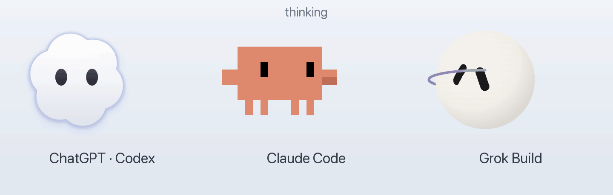
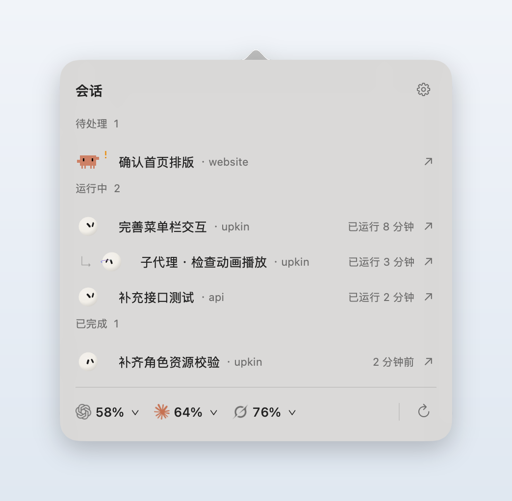
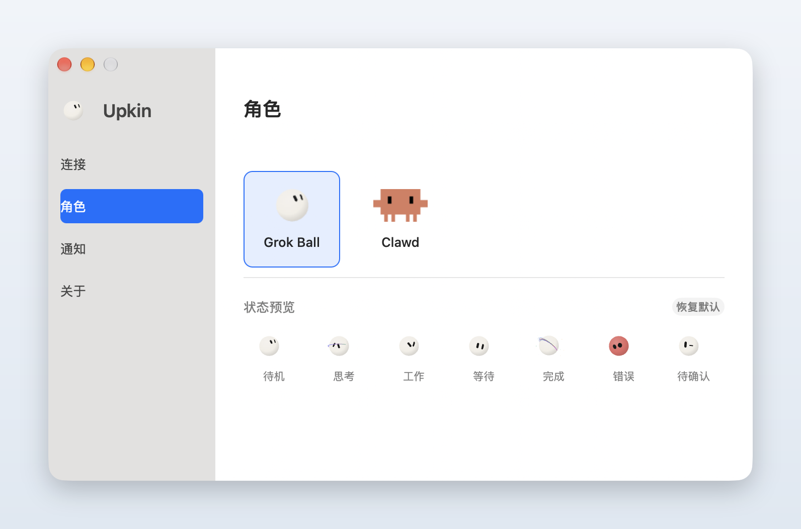
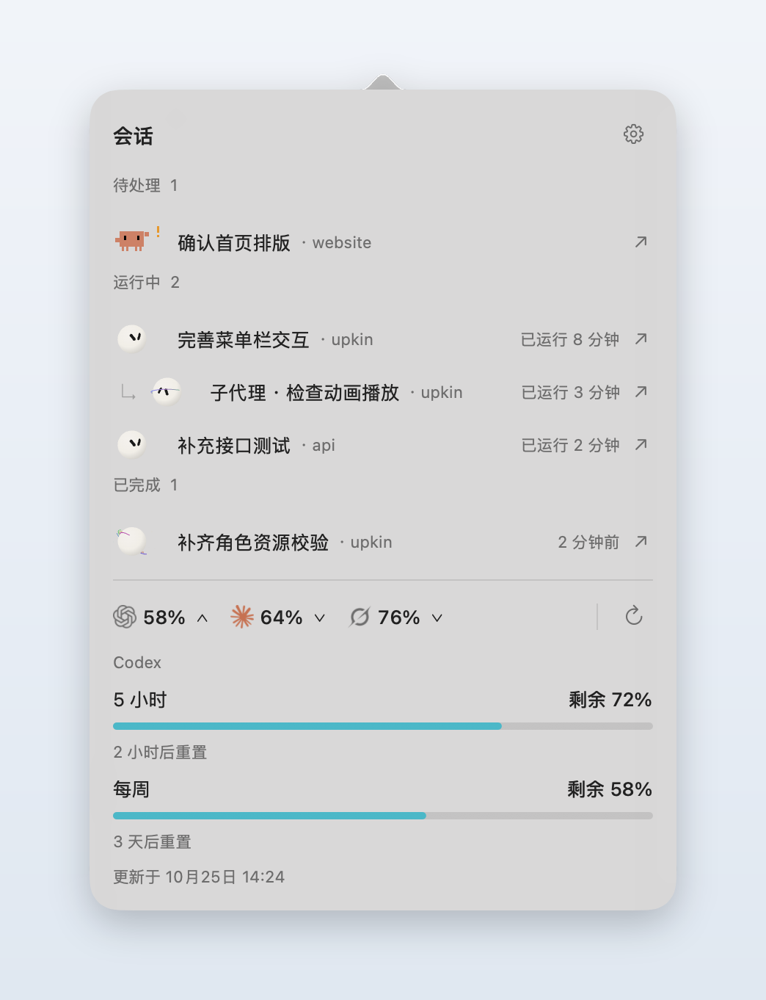
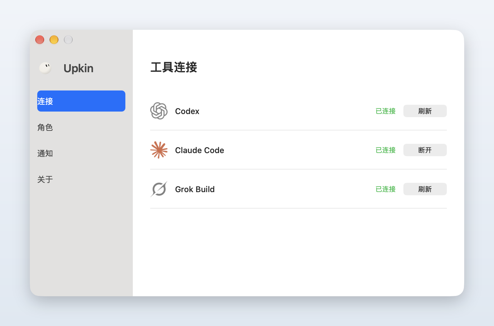
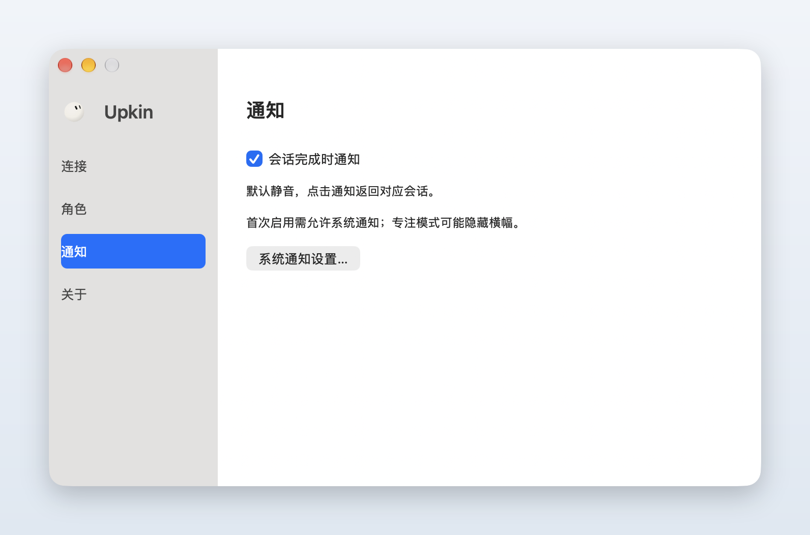

<p align="center">
  
</p>

<div align="center">
  <h1>Upkin</h1>
  <p><b>住在 macOS 菜单栏里的小角色，实时告诉你 AI 编程助手在干什么。</b></p>
  <p>简体中文 · <a href="README.en.md">English</a></p>
  <a href="https://github.com/clever-elephant/upkin/releases"></a>
  
  <a href="https://github.com/clever-elephant/upkin/actions/workflows/ci.yml"></a>
  <a href="LICENSE"></a>
</div>

<p align="center">
  
</p>

我平时会同时开着 Codex、Claude Code 和 Grok Build，经常切回终端才发现它早就跑完了，或者一直卡在等我确认。Upkin 给每个工具配了一个小角色：它在想、在干活、在等你，还是已经完成，看一眼菜单栏就知道。点开面板还能看到会话列表和剩余额度，一键跳回对应的会话。

## 功能

- **实时状态**：思考、工作、等你确认、完成、出错，每个状态一套完整的动画，菜单栏里以 15 FPS 原生播放
- **三个工具一起看**：Codex、Claude Code、Grok Build 分别跟踪，只装其中一两个也能用；同时在跑时显示最近开始的那个
- **会话一览**：按待处理、运行中、已完成分组，Codex 子任务挂在主任务下；点一下跳回 Codex 桌面应用或 iTerm 标签页
- **额度**：剩余额度和重置时间直接显示在菜单栏，⌘R 刷新
- **完成提醒**：任务跑完弹一个静音通知，可关
- **换个角色**：内置 ChatGPT、Clawd、Grok 三个角色，也可以导入自己做的[角色包](docs/character-packs.md)
- **轻**：原生 AppKit，没有 WebView、没有常驻后台进程，会话内容只在本机读取

## 快速开始

从 **[GitHub Releases](https://github.com/clever-elephant/upkin/releases/latest)** 下载 `Upkin-<版本>-macos.zip`，解压后把 `Upkin.app` 拖进「应用程序」。支持 macOS 14 以上，Apple Silicon 和 Intel 通用。

> [!NOTE]
> 应用暂未经过 Apple 公证，第一次打开会被系统拦下。到「系统设置 → 隐私与安全性」点「仍要打开」，或者在终端运行：
> ```bash
> xattr -dr com.apple.quarantine /Applications/Upkin.app
> ```

打开后它只待在菜单栏，Dock 里没有图标；设置在面板右上角的齿轮里。Codex 开箱即用，Claude Code 和 Grok Build 在「设置 → 连接」里点一下就能接上。

<details>
<summary><strong>从源码构建</strong></summary>
<br/>

需要 Swift 6（Xcode 16 或 Command Line Tools 自带）。

```bash
git clone https://github.com/clever-elephant/upkin.git
cd upkin
./Scripts/build_app.sh
open Upkin.app
```

更详细的说明见[使用指南](docs/getting-started.md)。

</details>

## 支持的工具

| 工具 | 会话状态 | 额度 | 跳回会话 |
| --- | --- | --- | --- |
| **Codex** | 直接读本地会话，无需配置 | 登录 ChatGPT 账号的 Codex CLI 或桌面应用 | 桌面应用 / iTerm |
| **Claude Code** | 需要[装 hooks](docs/grok-claude-activity.md) | 在「设置 → 连接」授权，仅限订阅账号 | iTerm |
| **Grok Build** | 需要[装 hooks](docs/grok-claude-activity.md) | 登录 Grok CLI 即可 | iTerm |

hooks 需要 Python 3，只在你点「连接」时安装，会保留你已有的其他 hooks。不想用了就运行 `python3 Scripts/configure_agent_hooks.py --remove`。第一次跳转 iTerm 时 macOS 会询问自动化权限。

## 截图

<p align="center">
  <picture>
    <source media="(prefers-color-scheme: dark)" srcset="docs/media/conversations-dark.png">
    
  </picture>
</p>

<details>
<summary>更多截图</summary>
<br>
<p align="center"><picture><source media="(prefers-color-scheme: dark)" srcset="docs/media/characters-dark.png"></picture></p>
<p align="center"><picture><source media="(prefers-color-scheme: dark)" srcset="docs/media/quota-dark.png"></picture></p>
<p align="center"><picture><source media="(prefers-color-scheme: dark)" srcset="docs/media/connections-dark.png"></picture></p>
<p align="center"><picture><source media="(prefers-color-scheme: dark)" srcset="docs/media/notifications-dark.png"></picture></p>
</details>

截图中的任务和额度均为演示数据。

## 隐私

- 会话内容只在本机读取，不上传提示词、回复或项目文件，没有任何统计
- 联网只发生在查额度时：Codex 走本地 app-server，Claude 走 Anthropic OAuth 用量接口，Grok 走 CLI 自带的账单接口
- Claude 的凭据要你点了同意才会读，可在「管理… → 断开」撤销
- 启动和后台刷新不会改任何配置；读了哪些文件见[技术说明](docs/architecture.md)

## 文档

| 文档 | 内容 |
| --- | --- |
| [使用指南](docs/getting-started.md) | 安装、首次设置与常见问题 |
| [Claude / Grok 活动接入](docs/grok-claude-activity.md) | hooks 做了什么、怎么撤销 |
| [角色资源包](docs/character-packs.md) | 制作和导入自己的角色 |
| [角色动画规范](docs/character-animation-guidelines.md) | 动作节奏与表情约定 |
| [技术说明](docs/architecture.md) | 数据来源、读取范围与架构 |
| [发布流程](docs/releasing.md) | 打包与发版检查清单 |

## 已知问题

- 界面目前只有中文
- 状态由最近的事件推断，Claude / Grok 的任务超过一小时没有新事件会显示「待确认」
- Grok CLI 更新后额度查询可能失效
- Intel Mac 接多台显示器时，非活动屏幕的菜单栏可能只显示额度

## 参与贡献

欢迎提 [issue](https://github.com/clever-elephant/upkin/issues) 和 PR。本地开发：

```bash
swift build
swift run UpkinCoreTests
```

完整检查和约定见 [CONTRIBUTING.md](CONTRIBUTING.md)；安全问题请按 [SECURITY.md](SECURITY.md) 私下报告。

## 致谢

- [clawd-pet](https://github.com/abderrahimghazali/clawd-pet)：Clawd 的像素造型参考
- [Grok Ball](https://github.com/TyCoding/grok-ball)：Grok 角色的来源
- [RunCat Neo](https://github.com/runcat-dev/RunCatNeo)：菜单栏动画的实现思路
- [LobeHub Icons](https://github.com/lobehub/icons)：工具品牌图标

## 许可

源码以 [GNU AGPL-3.0](LICENSE) 发布，Copyright (C) 2026 clever-elephant。各角色与图标的来源和许可详见 [THIRD_PARTY_NOTICES.md](THIRD_PARTY_NOTICES.md)：

- **ChatGPT** 角色由 clever-elephant 绘制，AGPL-3.0；云形轮廓改编自 OpenAI Codex 标志，相关标志归 OpenAI 所有。
- **Clawd** 是 Anthropic 的角色。这里的像素画是非官方的同人演绎，基于 MIT 许可的 clawd-pet，不附带角色或商标的任何权利。
- **Grok** 角色来自 [TyCoding/grok-ball](https://github.com/TyCoding/grok-ball)，MIT。
- **应用图标** 由 clever-elephant 绘制，AGPL-3.0。

这是个人项目，与 OpenAI、Anthropic、xAI 均无关联，也未获其认可。
